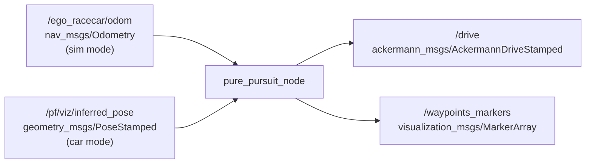

# pure_pursuit_ros2

Pure pursuit path tracking for F1TENTH in ROS 2 (C++), in simulation and on the car.

[](https://github.com/kaRpuri/pure_pursuit_ros2/actions/workflows/ci.yml)
[](https://docs.ros.org/en/humble/)
[](LICENSE)

## Demo


## How it works

The node loads a lap of waypoints from a CSV file and builds a KD-tree over them with nanoflann. On each pose update it queries the tree for the nearest waypoint, then walks forward along the lap until it finds the first waypoint at least `lookahead_distance` (L) away. That waypoint is the goal point. The goal point is rotated from the map frame into the vehicle frame using the car's orientation, which gives a lateral offset `y`. The curvature of the circular arc from the car through the goal point is `2 * y / L^2`, and the steering command is `steering_gain * curvature`. Speed is scaled down linearly as the steering angle grows, so the car slows in corners and runs faster on straights.

## Node graph



## Lookahead geometry

The car sits at the origin of the vehicle frame, with x forward and y to the left. The goal point is the first waypoint along the path that is at least L from the car, so it lies on or outside the lookahead circle of radius L. The controller steers along the circular arc that starts at the car and passes through the goal point.

```
                 y (left)
                  ^
                  |                      path
                  |              goal point
                  |                 *  . . . . .
                  |             .   |
                  |         .       |
                  |     .  L        |  y   lateral offset
                  | .   (lookahead) |      of the goal point
       car        |                 |
        O---------+-----------------+--------------> x (forward)
      (0, 0)
```

curvature = 2 * y / L^2, steering angle = steering_gain * curvature.

## Topics

| Topic | Type | Direction | Notes |
| --- | --- | --- | --- |
| `/ego_racecar/odom` | `nav_msgs/msg/Odometry` | subscribed | Used when `use_sim` is true |
| `/pf/viz/inferred_pose` | `geometry_msgs/msg/PoseStamped` | subscribed | Used when `use_sim` is false |
| `/drive` | `ackermann_msgs/msg/AckermannDriveStamped` | published | Speed and steering angle |
| `/waypoints_markers` | `visualization_msgs/msg/MarkerArray` | published | Waypoints for RViz, at 1 Hz |

## Parameters

| Name | Default | Meaning |
| --- | --- | --- |
| `use_sim` | `true` | True subscribes to the odometry topic. False subscribes to the pose topic. |
| `lookahead_distance` | `1.72` | Lookahead distance L in meters. The car config uses 2.7 to account for slip. |
| `steering_gain` | `0.435` | Multiplier applied to the arc curvature to get the steering angle. |
| `max_steering` | `0.4` | Steering angle in radians treated as full lock when scaling speed. |
| `max_speed` | `4.5` | Speed in m/s at zero steering, before the clamps described below. |
| `min_speed` | `1.5` | Speed in m/s at full steering, before the clamps described below. |
| `waypoints_file` | `levine2.csv` | File name inside `share/pure_pursuit/waypoints/`. |
| `odom_topic` | `/ego_racecar/odom` | Odometry topic for simulation. |
| `pose_topic` | `/pf/viz/inferred_pose` | Pose topic for the car. |
| `drive_topic` | `/drive` | Drive command topic. |

The speed profile also applies two fixed clamps after the linear scaling: values above 4.3 are raised to 5.0, and values below 2.0 are raised to 2.0. These were tuned on the car and are kept as is, so the commanded speed can reach 5.0 even though `max_speed` is 4.5.

## Quick start

Build:

```bash
cd ~/ros_ws
colcon build --packages-select pure_pursuit
source install/setup.bash
```

Run in simulation:

```bash
ros2 launch pure_pursuit pure_pursuit.launch.py mode:=sim
```

Run on the car:

```bash
ros2 launch pure_pursuit pure_pursuit.launch.py mode:=car
```

Car mode does not use odometry. It expects a particle filter to be running and publishing the car pose on `/pf/viz/inferred_pose` in the map frame.

Run the unit tests:

```bash
colcon test --packages-select pure_pursuit
colcon test-result --verbose
```

To see the waypoints and the drive command in RViz2, add the `/waypoints_markers` and `/drive` topics.

## Repo structure

```
pure_pursuit_ros2/
├── README.md
├── LICENSE
├── .github/workflows/ci.yml
├── maps/                      # levine_race5 map for the simulator
├── assets/                    # README images
└── pure_pursuit/
    ├── package.xml
    ├── CMakeLists.txt
    ├── include/pure_pursuit/
    │   ├── pure_pursuit_core.hpp    # the controller math, no ROS
    │   └── third_party/nanoflann.hpp
    ├── src/pure_pursuit_node.cpp    # ROS node, topics and parameters
    ├── config/
    │   ├── pure_pursuit_sim.yaml
    │   └── pure_pursuit_car.yaml
    ├── launch/pure_pursuit.launch.py
    ├── waypoints/levine2.csv
    └── test/test_pure_pursuit_core.cpp
```

The controller math lives in `pure_pursuit_core.hpp` as free functions with no ROS types. The node reads parameters, finds the goal waypoint and publishes. The tests in `test/` cover the math directly.

## Acknowledgments

- [nanoflann](https://github.com/jlblancoc/nanoflann) by Jose Luis Blanco Claraco, vendored as a single header under `include/pure_pursuit/third_party/`. BSD license, header kept intact.
- [F1TENTH](https://f1tenth.org/) for the vehicle platform and the gym simulator.
- The `levine_race5` map in `maps/` is of Levine Hall at the University of Pennsylvania, recorded on the F1TENTH platform.
